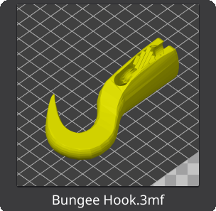

# 3mfthumb

Show 3MF and STL previews in file managers: use the package's embedded thumbnail image, or render the meshes when there is none.

Preview images are great. As .3mf is supposed to be the universal 3D Printing standard, and adoption is expected to be rapid, we should be able to see embedded thumbnail image previews for them in file managers like `pcmanfm`, `nautilus`, or even Windows `explorer`.

<div style="text-align: center;">
    <figure>
    
    <br>
        <figcaption><em>Figure 1: Bungee Hook.3mf <a href="https://www.printables.com/model/1361093-adjustable-bungee-hook">available on Printables.com</a></em></figcaptoin>
    </figure>
</div>

## Changelog

**Unreleased**

- Render `.glb` (binary glTF) files, and register `model/gltf-binary` in
  `3mf.thumbnailer` and the KDE plugin. A preview kept in the asset's
  `extras` is used when present; otherwise `gltf.h` flattens the scene's
  node hierarchy and materials into the same triangle renderer as 3MF and
  STL. Draco- and meshopt-compressed meshes are not decoded and are skipped.
- Render `.stl` files (binary and ASCII) with the same renderer, and register
  `model/stl` / `application/sla` in `3mf.thumbnailer`. STL has no embedded
  preview, so it is always rendered. `3mfthumb model.stl out.png` now works.
- New `-c` / `--cache` writes the image into the shared freedesktop thumbnail
  cache (`~/.cache/thumbnails/<group>/<md5 of file URI>.png`), and `-s N` /
  `--size N` sets the render size (default 256). The output path may then be
  omitted.
- Rendered images have a transparent background; `-b RRGGBB` / `--background
  RRGGBB` composites them onto a solid colour instead, `-f RRGGBB` /
  `--foreground RRGGBB` recolours triangles that have no material colour (STL
  and most glTF), and `-h` / `--help` prints the usage text.
- `-x DEG` / `--roll` (0), `-y DEG` / `--tilt` (30, 0 to 90) and `-z DEG` /
  `--spin` (35) aim the camera about its line of sight, above the plate and
  around it. The values are absolute: `-y 0` looks at the model head-on,
  `-y 90` straight down, and `-z 0` faces its front.
  Both default to 0, which is the view `3mfthumb` has always used (30 degrees
  above the plate, 35 degrees to the right); they only affect rendered images,
  not an embedded preview.
- New KDE thumbnail plugin (`kde-shellext/`), so Dolphin shows 3MF and STL
  previews. Built with CMake and installed by `make install` when Qt 6 and
  KF6 KIO are present, and packaged separately as `3mfthumb-kde`
  (RPM subpackage and DEB) so it never pulls Qt into non-KDE systems.

**1.2.2**

- `make install` / `make uninstall` now refuse to run without root, and
  install only to `PREFIX` (`/usr`): `/usr/bin/3mfthumb` and
  `/usr/share/thumbnailers/3mf.thumbnailer`. Nautilus runs thumbnailers in a
  bubblewrap sandbox that mounts only `/usr` and cannot exec anything from a
  home directory; it freezes instead of showing no preview. Until Nautilus
  changes, a `*.thumbnailer` in `~/.local/share/thumbnailers` only works if
  its `Exec` points at a program the sandbox can reach, such as
  `/usr/bin/3mfthumb`.
- Dropped the `nautilus-thumbnailers.gresource` overlay and `make
  install-nautilus`; the overlay made Nautilus hang at startup. This also
  removes the `glib2-devel` build requirement from the RPM.
- Both targets restart Nautilus for the desktop user (`setpriv` plus that
  user's session bus) instead of leaving it to the user.
- Fixed `file://` URI decoding (and `file://localhost/`), which previously
  wrote no thumbnail at all.

**1.2.1**

- Windows Explorer renders 3MF files that have no stored thumbnail image.

**1.2.0**

- Render the meshes when a package has no embedded preview image, and add
  `-r` / `--render`.

## Get it from GitHub

```
git clone https://github.com/themanyone/3mfthumb.git
cd 3mfthumb
```

## Linux dependencies

Fedora, Centos.
`dnf install libzip-devel lib3mf-devel cairo-devel zlib-ng-devel`

Ubuntu, Debian.
`apt install libzip-dev lib3mf-dev libcairo2-dev zlib1g-dev`

Arch
`pacman -S libzip lib3mf cairo zlib`

We will assume a GNU build environment with tools like `gcc-c++`, `pkg-config` and `make`.

## Linux Build

```
make
sudo make install
```

Earlier versions allowed installing as a non-privileged user. But that was
incompatible with the direciton Nautilus & other file managers are going.

Any `~/.local` copy left over from older versions should be removed,
together with the old `~/.local/lib64/nautilus/extensions-4/nautilus-thumbnailers.gresource`
overlay (`make install-nautilus`, since removed), which made Nautilus hang at
startup:

```
rm -f ~/.local/bin/3mfthumb ~/.local/share/thumbnailers/3mf.thumbnailer \
    ~/.local/lib64/nautilus/extensions-4/nautilus-thumbnailers.gresource*
```

Clear thumbnail cache & restart the file manager.

```
rm -rf $HOME/.cache/thumbnails/*
nautilus -q
```

Don't forget to configure file manager preferences to show previews for files > 1MB.

`sudo make uninstall` removes these components again.

### Nautilus does not show previews

Nautilus 43 and later reads thumbnailer entries only from
`/usr/share/thumbnailers/`

GNOME's thumbnail sandbox is why the binary has to live in `/usr/bin`.
See [Nautilus / GNOME sandboxing](#nautilus--gnome-sandboxing) below.

#### When a distribution already registers another thumbnailer.

**It's probably fine.** But *before reporting bugs*, here's a potential solution.

Distributions may ship `other thumbnailers` for `model/3mf` or `model/stl`, and two
thumbnailers claiming the same MIME type is confusing.

Run `grep -io model/3mf /usr/share/thumbnailers/*`

If more than one thumbnailer comes up, consider uninstalling conflicting thumbnailer packages, or editing their thumbnailer entries.

Remove old `3mf.thumbnailer` and any other thumbnailers you don't want from `/usr/local/share/thumbnailers`
`~/.local/share/thumbnailers` and `/usr/share/thumbnailers`.

Reinstall our `/usr/share/thumbnailers/3mf.thumbnailer`.

Clear thumbnail cache & restart the file managers.

```
rm -rf ~/.cache/thumbnails/*
nautilus -q
```

#### KDE (Dolphin)

KDE does not use freedesktop `.thumbnailer` files; Dolphin, the file dialog
and `kio-extras` load thumbnail plugins from a shared library. `3mfthumb` ships
one in `kde-shellext/`: it draws with the same mesh renderer, returns the 3MF
package thumbnail when the file has one, and lets KIO write the shared
thumbnail cache (`CacheThumbnail=true`).

Packages keep it separate so only KDE users get the Qt and KIO dependencies:
the `3mfthumb-kde` RPM subpackage, and a `3mfthumb-kde` deb built by
`make-deb.sh` (and by `debian/control`, which is a second binary package).
`make install` builds and installs it when CMake, Qt 6 and KF6 KIO are
installed, otherwise it prints a note and skips it. To do it by hand:

```
cmake -S kde-shellext -B build-kde
cmake --build build-kde
sudo cmake --install build-kde
```

That leaves `lib3mfthumbnail.so` and `3mfthumbnail.json` in Qt's
`thumbcreator` plugin directory (`/usr/lib64/qt6/plugins/thumbcreator` on
Fedora). The binary is also usable from a terminal or script, which copies the
result into the shared cache:

```
3mfthumb -c model.stl                  # 256px into ~/.cache/thumbnails/large/
3mfthumb -c -s 512 model.stl out.png   # 512px into x-large/ as well
```

#### Other Linux packages

The RPM and the DEB install `/usr/bin/3mfthumb` and
`/usr/share/thumbnailers/3mf.thumbnailer`, so they work with the sandbox as
they are; nothing in them needs changing for this.

PCManFM, Thunar and `gtk-thumbnail-factory` honour
`~/.local/share/thumbnailers` and are fine with running anything from home directories.

## Developer logic

The current version of the [Lib3MF](https://3mf.io/) API uses the `lib3mf_implicit.hpp` 
header file instead of Lib3MF_Resources.hpp. Available from the 
[3MF SDK](https://github.com/3MFConsortium/lib3mf/releases), this newer API provides a 
simplified interface for working with the Lib3MF library. If installed in a 
different place, you can use the `updatedb` and `locate` commands to find it.

This code employs the `CWrapper::loadLibrary()` method to load the Lib3MF library and create a 
new model. It then uses the `QueryReader()` method to create a new reader for the 3MF file 
format and read the model from a file using `ReadFromFile()`. Finally, we query the 
`HasPackageThumbnailAttachment()` and `GetPackageThumbnailAttachment()` methods to retrieve the thumbnail 
attachment and write it to a file using `WriteToFile()`.

When a package carries no preview image (slicers can be configured to embed them),
the mesh is traversed instead: component transforms are
composed (including objects stored in separate `p:path` model parts), the
model is viewed from a 35 degree yaw / 30 degree elevation orbit camera with
Lambert shading, painted back to front through Cairo. `-x`, `-y` and `-z` aim
that camera before the model is drawn. Material colours from
`basematerials` and `m:colorgroup` are used when present. This is a plain
preview, not a full renderer: no textures, beam lattices or level sets.

Use `3mfthumb -r in.3mf out.png` (or `--render`) to render the meshes even
when the package does have an embedded preview.

## Build problems

The `Makefile` uses `pkg-config --cflags --libs lib3mf cairo` to obtain the compiler flags to use. In particular, the location of `lib3mf_implicit.hpp`. If for some reason your system does not have pkg-config, you might be able to substitute these into the `Makefile`.

`BUILD_CFLAGS:=-I/usr/include/lib3mf`

`LDFLAGS:=-l3mf -lzip -lz -lcairo`

On Arch, `lib3mf-dev` may not be properly installed. The build script forgot to create simlinks to the C bindings. It should be filed as a bug. A command such as th following might work around the issue.

`ln -s /usr/include/lib3mf/Bindings/Cpp/* /usr/include/lib3mf/`

## Using [lib3mf_sdk](https://github.com/3MFConsortium/lib3mf/)

If it stubbornly refuses to build using the distro-provided packages, install zlib and libzip, or make sure their development libraries are installed. Then get the SDK.

```
cd #3mfthumb src dir
wget https://github.com/3MFConsortium/lib3mf/releases/download/v2.4.1/lib3mf_sdk_v2.4.1.zip
unzip lib3mf_sdk*
```

Now we can build 3mfthumb

```
make CFLAGS=-I./lib3mf_sdk/Bindings/Cpp LDFLAGS="-l3mf -lzip -lz -lcairo -L./lib3mf_sdk/Lib"
```

## Fedora RPM

`3mfthumb.spec` packages the binary and the thumbnailer definition as
`/usr/bin/3mfthumb` and `/usr/share/thumbnailers/3mf.thumbnailer`. The KDE
Dolphin plugin is a separate subpackage, `3mfthumb-kde`, so the base package
stays free of Qt 6 and KIO:
`dnf install 3mfthumb-kde`.

**Grab the latest package here:**
[Download `3mfthumb-1.2.2-1.fc43.x86_64.rpm`](https://github.com/themanyone/3mfthumb/releases/latest)
and install it with `sudo dnf install ./3mfthumb-1.2.2-1.fc43.x86_64.rpm`.
The matching source RPM is on the same release page.

`make rpm` builds the binary RPM and the source RPM locally. It downloads
the v1.1.0 GitHub archive (verified to contain every tracked file) into
`~/rpmbuild/SOURCES` if needed, then runs `rpmbuild -ba`. Output lands in
`~/rpmbuild/RPMS` and `~/rpmbuild/SRPMS`; set `RPM_TOPDIR` for a different
tree. The target needs `rpm-build`, `spectool` and network access, and
leaves nothing behind in the source tree.

The spec no longer ships a `nautilus-thumbnailers.gresource` overlay (it made
Nautilus hang at startup) and no longer needs `glib2-devel`; like the DEB it
relies on `/usr/share/thumbnailers`, which Nautilus reads and the thumbnail
sandbox can reach.

`rpmlint 3mfthumb.spec` reports no packaging errors. The remaining notices
are inherited from upstream: the postal address in the GPL text is out of
date. The missing man page and `%check` section are also tolerated.

The spec builds with upstream's `Makefile`, not with `%cmake`: the only
CMake harness in the tree is the untracked Windows cross-build file, so
Ninja is not involved.

## Debian / Ubuntu DEB

**Grab the latest package here:**
[Download `3mfthumb_1.2.2-1_amd64.deb`](https://github.com/themanyone/3mfthumb/releases/latest)
and install it with `sudo apt install ./3mfthumb_1.2.2-1_amd64.deb`.
The package depends on `lib3mf1`, `libzip5`, `libcairo2` and `zlib1g`, which apt pulls in
from the distribution. Afterwards run `rm -rf $HOME/.cache/thumbnails/*` so
file managers regenerate previews.

**Caveat: the published `.deb` is built on Fedora, not Debian.** It needs
glibc 2.34 or newer, so Ubuntu 22.04 and later and Debian 12 and later can
use it, while older releases (Ubuntu 20.04, Debian 11) will reject it with
a `GLIBC_2.xx not found` error. On those systems, or on ARM/RISC-V or other
non-amd64 machines, build the package locally with `make deb` below, which
links against the host's own libraries.

`make deb` builds the same package locally (see
[issue #7](https://github.com/themanyone/3mfthumb/issues/7)) using nothing but
`dpkg-deb`, a C++ compiler and `pkg-config` -- no `debhelper`, no `dpkg-dev`:

```
sudo apt install lib3mf-dev libzip-dev libcairo2-dev zlib1g-dev
make deb
sudo apt install ./3mfthumb_1.2.2-1_amd64.deb
```

The package installs `/usr/bin/3mfthumb` and
`/usr/share/thumbnailers/3mf.thumbnailer`. The version is read from
`3mfthumb.spec` and the revision from `debian/changelog`; override either
with `VERSION=...` / `REVISION=...` (`ARCH=i386` cross-arch packages are
possible on a Debian host that has the matching libraries).

The `debian/` directory is also a complete `debhelper` source package, so
the usual tooling works on a release tree:

```
git archive --format=tar --prefix=3mfthumb-1.2.2/ v1.2.2 | tar -x
cd 3mfthumb-1.2.2 && sudo apt install debhelper dpkg-dev
dpkg-buildpackage -us -uc -b
```

`debian/rules` calls upstream's `Makefile` directly (the same reasoning as
the RPM spec) and stages `/usr/bin/3mfthumb` plus
`/usr/share/thumbnailers/3mf.thumbnailer` itself. This tree is also what a Debian or Ubuntu upload or a PPA
build would use.

## Cross compiling to Windows

**Fedora dependencies.**

```
sudo dnf install mingw64-nsis python3-scons
```

To build Windows executable on Linux system, Use the distro's package manager to install `mingw64-gcc-g++`, `mingw64-zlib`, and `mingw64-libzip`. Now we need the `lib3mf.dll`, available from the above SDK download.

Now use `mingw64-make` to build the windows executable, `3mfthumb.exe`. Set LIBS to the location of the extracted lib3mf/Lib dir, which should already contain a precompiled library `lib3mf.dll`.

```
mingw64-env #important!
mingw64-make CFLAGS=-I./lib3mf_sdk/Bindings/Cpp LDFLAGS="-l3mf -lzip -lz -lcairo -L./lib3mf_sdk/Lib"
```

**Alternative cmake Windows build.**

```
cmake -S . -B build-win -DCMAKE_SYSTEM_NAME=Windows \ -DCMAKE_CXX_COMPILER=x86_64-w64-mingw32-g++
cmake --build build-win
```

## Windows install

**Grab the latest installer right here:**
[Download `3mfthumb-setup.exe`](https://github.com/themanyone/3mfthumb/releases/latest).
It is a per-user NSIS installer that installs the shell extension, registers
the COM server, and wires up a normal uninstall entry -- all without
administrator rights.

**Building from source.** See [`win-installer/`](win-installer/): `build.sh`
cross-compiles the shell extension (and the CLI), and produces the per-user
NSIS installer (`3mfthumb-setup.exe`) that installs the files, registers the
COM server, and adds the uninstall entry.

**Manual cross-compile & install.**
`3mfthumb.exe` itself is just a command-line converter (`3mfthumb file.3mf out.png`)
-- it's not something Windows Explorer can call on its own. Explorer only
generates thumbnails through a registered in-process COM object that
implements `IThumbnailProvider`; there's no "run this exe and read its
output" mechanism the way there is for `pcmanfm`/`nautilus` on Linux. (An
earlier version of this README suggested pointing a `ThumbnailHandler`
registry value straight at `3mfthumb.exe` -- that doesn't work, since that
registry slot expects a CLSID, not an executable path.)

The [`win-shellext/`](win-shellext/) directory has the real fix: a small
COM shell extension DLL that reuses the same lib3mf extraction logic and
hands Explorer a proper thumbnail bitmap. See
[`win-shellext/README.md`](win-shellext/README.md) for build and install
instructions. Summary:

```
# cross-compile from Linux with mingw-w64
sudo apt install g++-mingw-w64-x86-64-win32
cd win-shellext
x86_64-w64-mingw32-g++ -std=c++17 -Wall -O2 \
  -I../lib3mf_sdk/lib3mf_sdk/Bindings/CppDynamic \
  -c ThumbnailProvider.cpp -o ThumbnailProvider.o
x86_64-w64-mingw32-g++ -shared -o 3mfthumbprovider.dll \
  ThumbnailProvider.o ThumbnailProvider.def \
  -lshlwapi -lole32 -loleaut32 -luuid -lgdi32 -lwindowscodecs \
  -static-libgcc -static-libstdc++
```

Then on the Windows machine, copy `3mfthumbprovider.dll` and `lib3mf.dll`
(from `lib3mf_sdk/lib3mf_sdk/Bin/`) to wherever you want them to live, and
register:

```
regsvr32 3mfthumbprovider.dll
```

This registers under `HKEY_CURRENT_USER\Software\Classes`, so no
administrator rights are needed. `regsvr32 /u 3mfthumbprovider.dll` undoes
it. Verified working against real Windows Explorer (via
`IShellItemImageFactory::GetImage`, the same API Explorer itself uses).

## Nautilus / GNOME sandboxing

GNOME file managers run thumbnailers inside a
[bubblewrap](https://gitlab.gnome.org/GNOME/gnome-desktop#thumbnailing-sandboxing)
sandbox that mounts only `/usr`, `/proc` and `/dev` (no `$HOME`, no
`/usr/local`) and execs the program by name through the caller's `PATH`. The
binary therefore has to be installed as `/usr/bin/3mfthumb`, which is what
`sudo make install`, the RPM and the DEB do; a `~/.local/bin` or
`/usr/local/bin` install was never found and Nautilus showed no preview. It actually froze. The
sandbox passes a plain path (`%i` is rewritten to
`/tmp/gnome-desktop-file-to-thumbnail.3mf`), and `3mfthumb` accepts both that
and `file://` URIs with percent-escaped characters, so plain paths work too.

**Ad:** If you'd like to run something in a sandbox ^^^ like the above ^^^
or put AI in a sandbox, check out [my sbx project](https://github.com/themanyone/sbx).
But please note that a sandbox is for safety, not security. It prevents accidental
file access. This is old news. But since AI companies still haven't figured it out:
**Attention: Malicious AI software can get around it.**

The actual `bwrap` command that Nautilus ends up running looks like this:

```
bwrap --ro-bind /usr /usr --ro-bind-try /etc/ld.so.cache \
      --symlink /usr//bin /bin --symlink /usr//lib64 /lib64 ... \
      --proc /proc --dev /dev --chdir / --unshare-all --die-with-parent \
      --ro-bind /path/to/model.3mf /tmp/gnome-desktop-file-to-thumbnail.3mf \
      3mfthumb /tmp/gnome-desktop-file-to-thumbnail.3mf /tmp/gnome-desktop-thumbnailer.png
```

## Known Issues

Windows Explorer thumbnails now work via the COM shell extension in

Windows Explorer thumbnails now work via the COM shell extension in
[`win-shellext/`](win-shellext/) -- see the Windows install section above.
Discuss issues on the [GitHub issue tracker](https://github.com/themanyone/3mfthumb/issues).

## Author's links

- [GitHub](https://github.com/themanyone)
- [YouTube](https://www.youtube.com/themanyone)
- [Mastodon](https://mastodon.social/@themanyone)
- [LinkedIn](https://www.linkedin.com/in/henry-kroll-iii-93860426/)
- [Buy me a coffee](https://buymeacoffee.com/isreality)
- [TheNerdShow.com](https://thenerdshow.com/)

Copyright (C) 2024-2026 [Henry Kroll III](https://thenerdshow.com/). See [LICENSE](LICENSE) for details.

Additions adding full Windows support by [Don Eisele](https://toysmakeuspowerful.com/), 2026.
